  

   

  <!-- Sleek Floating Pill Badges -->
  

    
    
    
    
  

 

<!-- Asymmetric Split Showcase: Custom Animated Simulation + Bio -->
<table>
  <tr>
    <td width="52%" valign="middle">
      <h3><code>⚡ System Architecture &amp; Focus</code></h3>
      

        Designing intelligent machines that perceive, reason, and navigate safely through complex, uncertain environments alongside humans and peer robots.
      

      

        🔭 <b>Research:</b> Autonomous Navigation, Multi-Sensor Fusion &amp; RL 
        🧠 <b>Intelligence:</b> Deep Fault Diagnosis &amp; Spatiotemporal Forecasting 
        ⚙️ <b>Systems:</b> ROS/ROS2, LiDAR SLAM &amp; Cyber-Physical Digital Twins 
        📍 <b>Location:</b> Dhaka, Bangladesh
      

       
      
    </td>
    <td width="48%" align="center" valign="middle">
      
    </td>
  </tr>
</table>

 

  <!-- Live Contribution Graph -->
  

