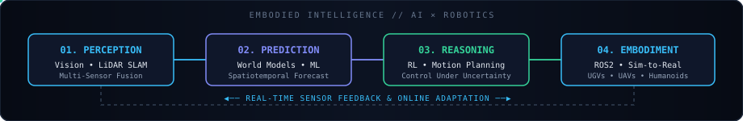
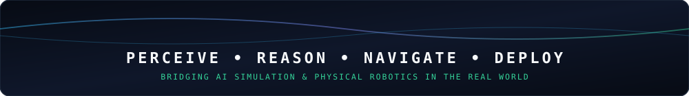

 

  

<pre><code class="language-yaml">Name:       Raif Tanjim
Role:       Robotics Engineer & AI Researcher 
Origin:     Dhaka, Bangladesh 🇧🇩
Primary:    Python / C++ / ROS & ROS2 / PyTorch / OpenCV
Domains:    Robotics, Computer Vision, Machine Learning, Forecasting
Focus:      Safe Embodied AI, Sim-to-Real, Multi-Robot & Decision-Making Under Uncertainty
Status:     ONLINE 🟢</code></pre>

### 🧭 Research Vision — Bridging AI Simulation & Physical Deployment

> *"Building and testing physical robots revealed how sensor noise, localization drift, and the gap between simulation and reality challenge autonomy driving my goal to fuse AI perception, learning, and control into reliable real-world machines."*

My work sits at the intersection of **Artificial Intelligence and Physical Robotics**, focused on developing intelligent systems that operate safely and reliably in uncertain, dynamic environments alongside people, peer robots, and physical obstacles.

Rather than stopping at idealized simulations, I design end-to-end pipelines that connect **AI robotics simulation**  with **physical embedded deployment** . Across my research and engineering projects, I combine **computer vision**, **multi-sensor SLAM**, **reinforcement learning (PPO/MPC)**, and **time-series forecasting** to give physical platforms situational awareness, predictive foresight, and adaptive autonomy.

 

  

### 🤖 Languages, Robotics & AI Frameworks

  
  
  
  
  
  
  
  
  

### 🛰️ Core Research & Engineering Pillars
<table align="center">
<tr>
<td align="center" width="25%"><b>🦾 Robotics</b> ROS/ROS2 • LiDAR SLAM • Sensor Fusion • Navigation</td>
<td align="center" width="25%"><b>👁️ Computer Vision</b> Object Detection • Thermal Vision • Defect Inspection</td>
<td align="center" width="25%"><b>🧠 Machine Learning</b> Deep Learning • RL (PPO/MPC) • Fault Diagnosis</td>
<td align="center" width="25%"><b>📈 Forecasting</b> Multi-Output LSTM • Time-Series &amp; Digital Twins</td>
</tr>
</table>

### 🛠️ Simulation, Digital Twins & Embedded Hardware

  
  
  
  
  
  
  
  

LiDAR • IMU • Thermal Imaging • Hardware-in-the-Loop Testing • SolidWorks • AutoCAD

  
  
  
  

<table align="center">
<tr>
<td width="25%" align="center">

### 🦾 Robotics
LiDAR SLAM, sensor fusion &amp; autonomous mobile navigation

</td>
<td width="25%" align="center">

### 👁️ Vision
Thermal imaging, defect inspection &amp; real-time perception

</td>
<td width="25%" align="center">

### 🧠 Machine Learning
RL (PPO/MPC), fault diagnosis &amp; edge anomaly detection

</td>
<td width="25%" align="center">

### 📈 Forecasting
Multi-output LSTM &amp; cyber-physical digital twin modeling

</td>
</tr>
</table>

Active objective: bridging AI robotics simulation with physical hardware deployment under real-world uncertainty.

Always open to research collaborations and challenging robotics, vision &amp; AI engineering problems.

 

  

▶ Sense • Perceive • Predict • Control • Deploy • Iterate ◀

