  <!-- Animated Hero Banner -->
  

  <!-- Animated Terminal Subheader -->
  

   

  <!-- Clean Social & Portfolio Links -->
  

    
    
    
    
  

---

<!-- Two-Column Visual Hero: Research Pillars + Simulation Visual -->
<table>
  <tr>
    <td width="56%" valign="top">
      <h3><code>// Research & Engineering Domains</code></h3>
      

        Exploring how intelligent machines perceive, reason, and act reliably inside complex, uncertain environments alongside humans and dynamic agents.
      

      <ul>
        <li><b>Autonomous Systems & Robotics:</b> ROS/ROS2 pipelines, LiDAR-inertial SLAM, multi-sensor fusion, and socially aware navigation.</li>
        <li><b>Learning Under Uncertainty:</b> Reinforcement learning, computer vision, and adaptive control for aerial and ground platforms.</li>
        <li><b>Cyber-Physical Intelligence:</b> Deep learning fault diagnosis, spatiotemporal forecasting, and predictive analytics for energy & industrial systems.</li>
      </ul>
       
      <b>Core Stack:</b> 
      
    </td>
    <td width="44%" align="center" valign="middle">
      <!-- Replace the src below with your own uploaded simulation GIF in /assets/sim.gif -->
      
       
      <i>Multi-agent perception & navigation in dynamic, uncertain environments</i>
    </td>
  </tr>
</table>

---

  <!-- Automated Contribution Snake Animation -->
  

